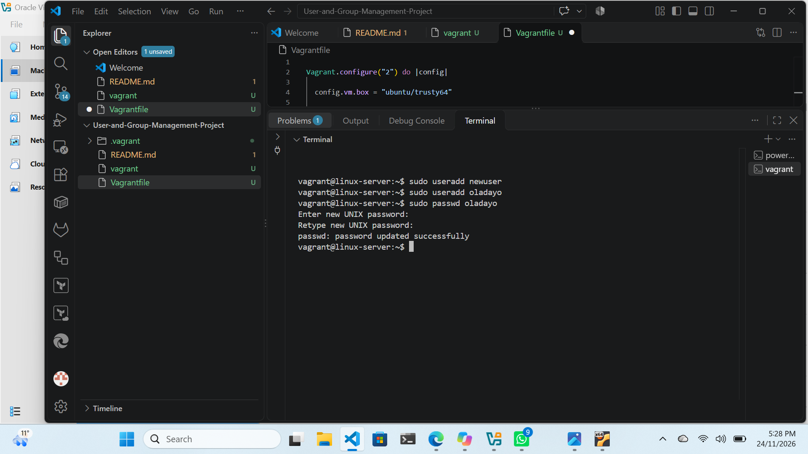
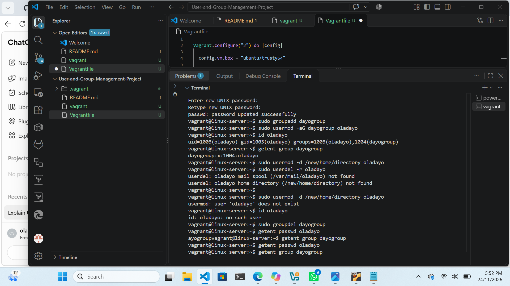
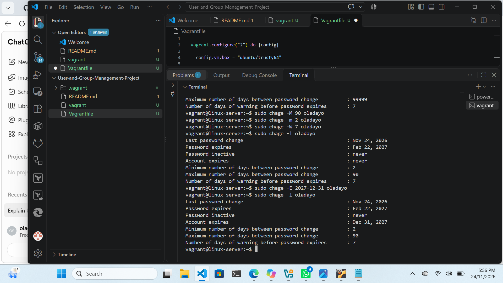

# Linux User and Group Management Project

## Objective

The objective of this project is to learn how to manage user accounts and groups on a Linux system. This includes creating, modifying, verifying and deleting users and groups using Linux commands.

## Step 1: Access the Linux System

I used a Vagrant Linux virtual machine to access a Linux environment.

```bash
vagrant ssh
```

## Step 2: Open a Terminal

After connecting to the Linux virtual machine, I used the terminal to execute Linux user and group management commands.

## Step 3: Create a New User

I used the `useradd` command to create a new user called oladayo.

```bash
sudo useradd oladayo
```

This command creates a new user account on the Linux system.

## Step 4: Set a Password for the New User

I used the `passwd` command to assign a password to the newly created user.

```bash
sudo passwd oladayo
```

The system prompted me to enter and confirm a new password.



## Step 5: Create a New Group

I created a group called `dayogroup` using the `groupadd` command.

```bash
sudo groupadd dayogroup
```

This creates a new group for organising users and managing permissions.

## Step 6: Add User to a Group

I added `oladayo to dayogroup` using the `usermod` command.

```bash
sudo usermod -aG dayogroup oladayo
```

- `-a` means append.
- `-G` specifies supplementary groups.

This adds the user to the group without removing existing supplementary group memberships.

## Step 7: Verify User and Group Creation

To confirm that the user and group were successfully created, I used the following commands.

**Check user information:**

```bash
id oladayo
```

**Check group information:**

```bash
getent group dayogroup
```

These commands display the user's ID, group memberships and group information.

## Step 8: Modify User and Group Information

Linux provides commands such as `usermod` and `groupmod` to modify user and group information.

**Change the user's home directory:**

```bash
sudo usermod -d /new/home/directory oladayo

Change the group name:

```bash
sudo groupmod -n updatedgroup dayogroup
```

## Step 9: Delete a User

To remove the user account, I used the `userdel` command.

```bash
sudo userdel -r oladayo
```

The `-r` option removes the user's home directory and mail spool along with the account.

**Note:** This operation should be performed carefully because deleting a user can result in permanent data loss.

## Step 10: Delete a Group

To delete the group, I used the `groupdel` command.

```bash
sudo groupdel dayogroup
```

This removes the group from the Linux system. The group must not be the primary group of an existing user.



## Step 11: Manage User Passwords (Optional)

Linux provides additional commands for managing passwords and account security.

**Check password status:**

```bash
sudo passwd -S oladayo
```

**Set an account expiry date:**

```bash
sudo chage -E 2027-12-31 oladayo
```

**View password ageing information:**

```bash
sudo chage -l oladayo
```

